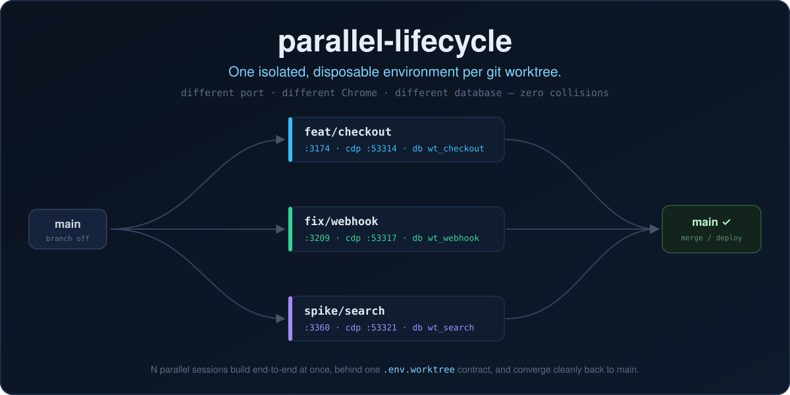
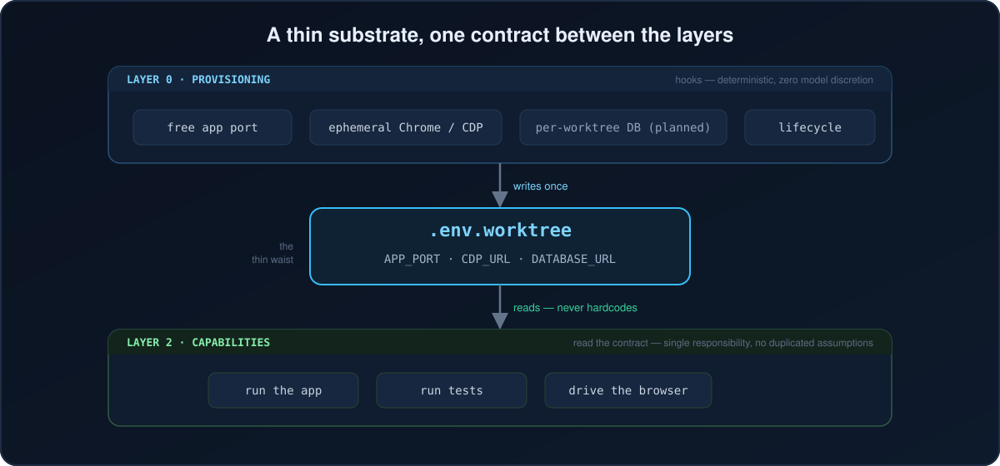

<div align="center">

<h1>parallel-lifecycle</h1>

<h3>
  <strong>One isolated, disposable environment per git worktree.</strong>
</h3>

<p>
  Run N agent sessions in parallel, one per worktree.<br>
  <strong>Each gets its own port, its own Chrome, its own database. Zero collisions.</strong>
</p>

<p>
  <em>The substrate parallel coding assumes exists — and never actually had.</em>
</p>

<a href="#how-it-works">
  
</a>

<p>
  <a href="#installation"></a>
  <a href="https://opensource.org/licenses/MIT"></a>
  <a href="https://claude.ai/code"></a>
  <a href="#platform-compatibility"></a>
  <a href="https://github.com/DevOtts"></a>
</p>

<p>
  <a href="#installation">Install</a>
  &nbsp;·&nbsp;
  <a href="#the-bottleneck-it-kills">Why</a>
  &nbsp;·&nbsp;
  <a href="#how-it-works">How it works</a>
  &nbsp;·&nbsp;
  <a href="#whats-inside">What's inside</a>
  &nbsp;·&nbsp;
  <a href="#proof">Proof</a>
  &nbsp;·&nbsp;
  <a href="#platform-compatibility">Platforms</a>
</p>

> [!NOTE]
> **Built for parallel agentic coding** — many worktrees, many sessions, one machine, no stepped-on toes.

<br>
</div>

Git worktrees isolate your **files**. They do nothing about everything else. The moment you run two coding sessions at once, both want port 3000, both hit the same local database, and both reach for the same browser. They overwrite each other's dev servers, corrupt each other's test data, and serialize on a single Chrome. Most "fixes" auto-increment the port ("3000 busy, use 3001") — which quietly points your test harness at the wrong URL, so it tests nothing and passes anyway.

`parallel-lifecycle` is the missing substrate. A `SessionStart` hook detects when you're in a linked worktree and provisions a deterministic free port, a throwaway Chrome bound to its own debugging port, and (planned) a database of its own — writing all of it to one file, `.env.worktree`. Your app and your tests read that one file. Open a second worktree and it gets a different everything. They never touch.

## The bottleneck it kills

You spin up three worktrees to build three features in parallel. Session A's dev server grabs `:3000`. Session B's grabs `:3000` too and silently fails, or evicts A. Session C's Playwright test connects to "the browser" and drives whichever tab happens to be focused. Test data from A's seed script lands in the same database B is asserting against. Nothing crashes loudly — it just produces **green tests that prove nothing**, which is worse.

The fix isn't more cleverness in each session. It's a floor underneath all of them that guarantees isolation *deterministically*, before any session writes a line of code. That floor is a hook, not a prompt — because a prompt is something a model can skip or forget, and "usually isolated" is the same bug as "never isolated."

<a href="#how-it-works">
  
</a>

## Installation

`parallel-lifecycle` ships as both a **Claude Code plugin** (the full, auto-wired experience) and a portable **`SKILL.md`** (the workflow, on any agent). Pick your tool.

> [!TIP]
> **Universal installers** understand the `SKILL.md` standard and drop the skill into the right place for 70+ tools — use these if your agent isn't listed below:
> ```sh
> npx skills add DevOtts/parallel-lifecycle -a <agent>   # e.g. -a cursor, -a codex ; add -g for global
> gh skill install DevOtts/parallel-lifecycle            # GitHub CLI
> ```
> Peek first with `npx skills add DevOtts/parallel-lifecycle --list`.

### Claude Code  ·  *native, full experience*

```sh
# 1. Register the marketplace
/plugin marketplace add DevOtts/parallel-lifecycle

# 2. Install the plugin (plugin-name@marketplace-name)
/plugin install parallel-lifecycle@parallel-lifecycle
```

This is the **only** target that auto-provisions: the plugin's `SessionStart` /
`SessionEnd` hooks fire on every session and no-op outside a linked worktree, so
isolation just happens — you never run a setup command. The `parallel-lifecycle`
skill rides on top for the test/browser workflow. *(Skills-CLI alternative:
`npx skills add DevOtts/parallel-lifecycle -a claude-code`.)*

### Cursor

```sh
npx skills add DevOtts/parallel-lifecycle -a cursor      # add -g for a global install
```

Installs the workflow skill into Cursor's `.agents/skills/`. Cursor has no
deterministic session hook, so provision each worktree with the bundled
`worktree-bootstrap.sh` (one command — see [Quick start](#quick-start)).

### Codex  ·  *OpenAI Codex CLI*

```sh
npx skills add DevOtts/parallel-lifecycle -a codex
# or:  gh skill install DevOtts/parallel-lifecycle
```

Lands in the shared `.agents/skills/` Codex reads. Run the provisioner manually
(or wire it into a git hook).

### VS Code + GitHub Copilot

```sh
npx skills add DevOtts/parallel-lifecycle -a github-copilot
# or:  gh skill install DevOtts/parallel-lifecycle
```

### Others  ·  *OpenCode · Windsurf · Zed · Gemini CLI · Cline · Amp · Warp …*

```sh
npx skills add DevOtts/parallel-lifecycle -a <agent>
```

Run `npx skills add DevOtts/parallel-lifecycle --list`, then target your agent.

### Any shell — no agent required

The provisioning layer is **plain bash keyed off `git worktree`**, so it works
with or without an AI tool. Wire it into a git hook, `direnv`, a `Makefile`, or
your shell:

```sh
git clone https://github.com/DevOtts/parallel-lifecycle /tmp/pl
cp /tmp/pl/plugins/parallel-lifecycle/hooks/worktree-*.sh ~/.local/bin/
# then call worktree-bootstrap.sh whenever you enter a worktree
```

> [!NOTE]
> On every target **except Claude Code**, you get the portable behavior layer —
> the workflow skill plus the bash provisioner — but not the automatic
> session-hook wiring (that's a Claude Code mechanism). Same isolation, one
> manual command. See [docs/installation.md](docs/installation.md) for the
> manual hook setup.

## How it works

A thin substrate with one contract between the layers. Nothing above the
contract re-derives where the app, the browser, or the database live — it reads
one file.



- **Layer 0 — Provisioning (hooks).** Deterministic, zero model discretion. On
  `SessionStart`, inside a linked worktree, it allocates free ports, launches an
  ephemeral headless Chrome on its own CDP port, and writes the contract. On
  `SessionEnd`, it kills that Chrome. It no-ops in the main checkout, so it's
  safe to leave on globally.
- **Layer 1 — The contract (`.env.worktree`).** The thin waist. `APP_PORT`,
  `CDP_URL`, `DATABASE_URL`. Deterministic free ports, written once — **not**
  auto-incremented, because an auto-incremented port silently points tests at
  the wrong URL.
- **Layer 2 — Capabilities.** Run the app, run tests, drive the browser. Each
  reads `$PORT` / `$CDP_URL` from the contract and contains no isolation logic of
  its own. Single responsibility, no duplicated environment assumptions.

Two design rules make it hold up end-to-end:

1. **Two browser models, kept separate.** Default is an *ephemeral* throwaway
   Chrome per worktree (fully parallel; for authenticated flows you inject a
   saved `storageState`, never the real profile). When a test genuinely needs
   your real, logged-in, anti-detection Chrome on `:9222`, that browser is a
   resource of one — you serialize it behind `flock` while code and dev servers
   stay parallel.
2. **Decoupled lifecycle clocks.** Cheap-to-rebuild resources (Chrome, port)
   live on the **session** clock — created on start, killed on end. The database
   (when enabled) lives on the **branch** clock — created once, dropped only on
   worktree-remove. So closing your laptop never nukes seed data mid-branch.

Full design, including the planned detection-first database isolation, is in
[docs/architecture.md](docs/architecture.md).

## Quick start

From inside a linked git worktree:

```bash
# On Claude Code the hook already wrote the contract. Elsewhere, provision once:
bash worktree-bootstrap.sh

# Load it, then start your app on the worktree's port (never hardcode 3000):
set -a; source .env.worktree; set +a
npm run dev

# Drive the worktree's own Chrome over CDP:
python3 connect.py        # bundled Playwright helper; reads $CDP_URL
```

Open a second worktree and repeat — different ports, a separate Chrome, no
collision. Authenticated flows, serializing the real browser, and cleanup are in
[docs/usage.md](docs/usage.md).

## What's inside

| Component | Layer | Role |
|-----------|-------|------|
| `worktree-bootstrap.sh` | 0 | `SessionStart` hook: allocate ports, launch ephemeral Chrome, write the contract. Idempotent, no-ops outside a worktree. |
| `worktree-teardown.sh` | 0 | `SessionEnd` hook: kill this worktree's Chrome. Never drops the database (that's the branch clock). |
| `hooks.json` | 0 | Registers both hooks for the Claude Code plugin via `${CLAUDE_PLUGIN_ROOT}`. |
| `.env.worktree` | 1 | The generated contract every other tool reads. |
| `parallel-lifecycle` skill | 2 | The test/browser workflow: model selection, `storageState` auth, serialization, cleanup. |
| `connect.py` | 2 | Playwright-over-CDP helper that connects to the worktree's Chrome and returns a page. |

## Proof

Two parallel worktrees, each provisioned by the hook, on one machine:

```text
worktree A (feat/checkout)     worktree B (fix/webhook)
  APP_PORT = 53313               APP_PORT = 53316      → distinct
  CDP_PORT = 53314               CDP_PORT = 53317      → distinct
  Chrome   pid 64892             Chrome   pid 64907    → two separate browsers
  CDP      ws://127.0.0.1:53314  ws://127.0.0.1:53317  → each its own, not :9222

connect.py (Playwright/CDP) → loaded the app on A's own port through A's own
Chrome: "OK http://127.0.0.1:53313/"
SessionEnd teardown → both Chromes killed (2 → 0).
```

No mocks, real ports, real browsers, a real CDP connection. That's the bar.

## Status

Early release (`0.1.0`), honest about scope. **Implemented:** per-worktree app
port and ephemeral Chrome/CDP isolation behind the contract, proven across
parallel worktrees (above). **Planned:** automatic, stack-detected per-worktree
**database** isolation, and capability skills that read the contract directly.
See the [roadmap](docs/architecture.md#roadmap).

Validate locally before relying on it:

```sh
claude plugin validate .                              # the marketplace
claude plugin validate ./plugins/parallel-lifecycle   # the plugin
```

## Security considerations

- **No secrets to install or run.** The substrate allocates ports and launches a
  local browser; it needs no credentials of its own.
- **The ephemeral Chrome is throwaway and starts logged out.** Authenticated
  tests inject a saved Playwright `storageState`; the real `--user-data-dir` is
  never copied into a worktree, and the real `:9222` browser is never driven by
  the default flow.
- **`.env.worktree` and `.wt/` are per-machine and git-ignored** — never
  committed, never transmitted.
- **The hook no-ops outside a linked worktree**, so registering it globally
  cannot affect your main checkout or non-git directories.

## Platform compatibility

The provisioning layer is `git` + `bash`; the workflow is a `SKILL.md`. So the
floor runs anywhere a shell does, and the skill installs anywhere the open
[Agent Skills](https://github.com/vercel-labs/skills) standard reaches.

| Platform | Status | What you get |
|----------|--------|--------------|
| Claude Code | ✅ Native | Plugin: hooks **auto-provision** every worktree + the skill |
| Cursor | ✅ Supported | Skill + bash provisioner (run once per worktree) |
| VS Code + GitHub Copilot | ✅ Supported | Skill + bash provisioner |
| Codex | ✅ Supported | Skill + bash provisioner |
| OpenCode · Windsurf · Zed · Cline · Amp · Warp · Gemini CLI · …50+ | ✅ Supported | `npx skills add DevOtts/parallel-lifecycle --list` |
| Any shell / CI (no agent) | ✅ Supported | The bash substrate via git hook, direnv, or Makefile |

**Legend** — **✅ Native:** hooks auto-provision; you never run a setup command.
**✅ Supported:** the portable skill + the bash provisioner install and run; you
provision each worktree with one command (or your own git hook) instead of the
automatic session wiring.

## License

MIT — see [LICENSE](LICENSE) and [plugin.json](plugins/parallel-lifecycle/.claude-plugin/plugin.json). Use it, fork it, ship with it.

---

_Built by [DevOtts](https://github.com/DevOtts)._
